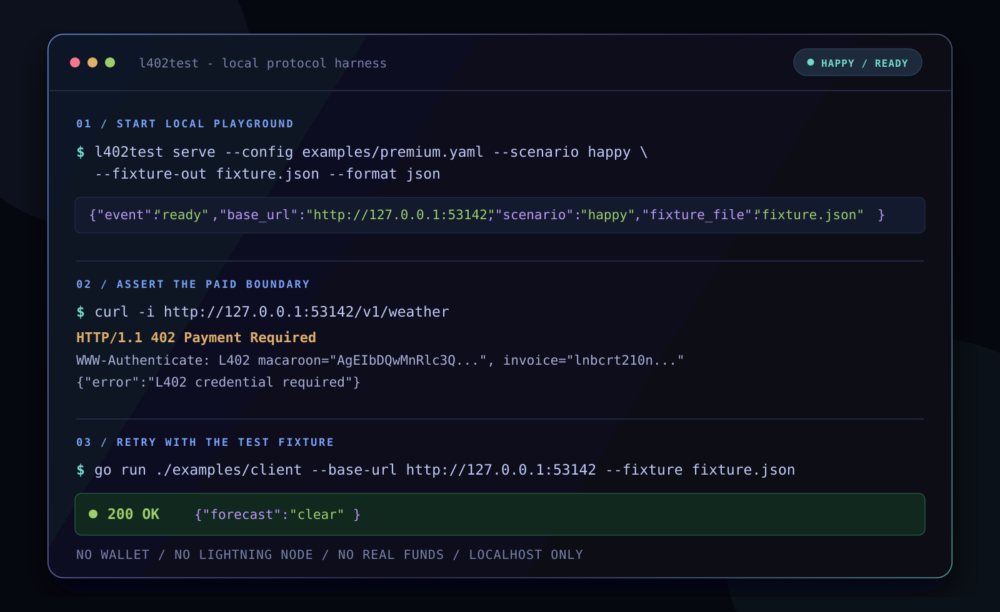
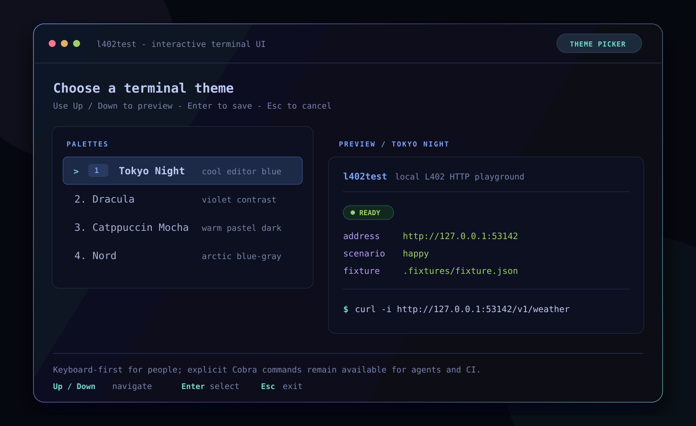

# l402test

`l402test` is a local HTTP playground for people building an L402 client, SDK,
or agent. It serves configurable premium endpoints and exercises the real HTTP
shape of an L402 exchange:

```text
unauthenticated request
  -> 402 + WWW-Authenticate: L402 macaroon="...", invoice="..."
  -> client obtains a test preimage from a fixture
  -> retry with Authorization: L402 <macaroon>:<preimage>
  -> configured premium response
```

It runs without a wallet, Lightning node, funds, database, telemetry, or
outbound network requests. Its BOLT11 invoices are structurally valid regtest
fixtures; they are deliberately not payable.

The HTTP contract follows the [L402 protocol specification](https://docs.lightning.engineering/the-lightning-network/l402/protocol-specification): a server challenges with an invoice and macaroon, and the client presents the macaroon plus hexadecimal preimage as its authorization credential.
For agent-oriented client behavior, see the upstream [L402 agent specification](https://github.com/lightninglabs/L402/blob/master/agent-spec.md).

## Screenshots

### Local L402 happy path



The server exposes the actual HTTP boundary a client needs to exercise:
unauthenticated request, `WWW-Authenticate` challenge, and a retry
using a test-only fixture. Credentials are deliberately shortened in the
capture.

### Keyboard-first launcher



In a real terminal, the launcher and palette picker support `Up`/`Down`,
`Enter`, and `Esc`. Scripts, agents, and CI use the explicit
Cobra commands instead, so their output remains stable and machine-readable.

## The job it does

### Who it is for

- Engineers maintaining an L402 consumer in an agent, SDK, or API client.
- API teams that want to test L402 behavior before connecting a real payment
  stack.
- CI suites that need repeatable 402, credential-refresh, and failure paths.

### The problem

An HTTP client can parse a normal `200` response without any payment setup.
L402 clients must also correctly handle a `402`, parse a structured
`WWW-Authenticate` challenge, associate an invoice with a preimage, retry with
an `Authorization` header, and react to expiry or a replacement credential.
Hand-written mocks often miss one of those boundaries; a full Lightning
environment can be unnecessary when the behavior under test is the HTTP
client.

### Positioning

`l402test` is a **protocol-level local test harness**, not a Lightning network
simulator or a payment product.

| If you need to... | Use |
| --- | --- |
| Test an HTTP L402 client/agent with deterministic challenges and fixtures | `l402test` |
| Model local Lightning nodes, channels, and regtest payments | [Polar](https://lightningpolar.com/) |
| Run a Docker-backed Bitcoin regtest stack, optionally with Lightning nodes | [Nigiri](https://github.com/vulpemventures/nigiri) |

Those tools solve complementary problems. Polar and Nigiri are appropriate
when node or network behavior matters. `l402test` deliberately removes that
infrastructure when the assertion is about the L402 HTTP contract.

### Deliberate non-goals

- Real invoice settlement, wallets, channels, routing, or node RPC.
- gRPC, MCP, a web dashboard, remote hosting, or persistence.
- Production authorization or billing.
- A client SDK. The included client is a small copyable example, not a public
  library API.

## Quick start

### Interactive launcher

From a clone of this repository:

```sh
go run ./cmd/l402test
```

In an interactive terminal, choose a color theme with the arrow keys and press
Enter. The launcher then shows the default workspace state:

- If `l402test.yaml` does not exist, choose **Create configuration**.
- Run the command again and choose **Start local playground**.
- The launcher writes its test-only fixture to `.fixtures/fixture.json` and
  displays the exact Cobra command it is about to run.

The launcher is for a human at a terminal. It never runs for piped output,
agents, CI, or JSON readiness mode.

### Automation-friendly flow

Use the explicit Cobra commands when a script, agent, or CI job owns the
process:

```sh
go run ./cmd/l402test init --output l402test.yaml
go run ./cmd/l402test validate --config l402test.yaml
go run ./cmd/l402test serve \
  --config l402test.yaml \
  --fixture-out fixture.json \
  --format json
```

The last command emits one machine-readable readiness record and continues
serving until it receives `Ctrl+C` or `SIGTERM`:

```json
{"event":"ready","base_url":"http://127.0.0.1:53142","scenario":"happy","fixture_file":"fixture.json"}
```

`fixture.json` is ignored by Git and contains **test preimages only**. Treat it
as test material: do not use it as a real payment credential and do not print
it in test logs.

## Try the complete exchange

With the playground running at the address reported in readiness output:

```sh
curl -i http://127.0.0.1:53142/v1/weather
```

The first request receives `402 Payment Required` and an L402 challenge. The
included example client demonstrates the retry using the local fixture:

```sh
go run ./examples/client \
  --base-url http://127.0.0.1:53142 \
  --fixture fixture.json
```

It sends the first request, parses the returned macaroon, reads the matching
test preimage, sends `Authorization: L402 <macaroon>:<preimage>`, and prints the
premium response. The example remains stdlib-only except for the internal L402
parser, so it can be adapted into a test client without introducing a wallet.

For the second endpoint in the supplied example configuration:

```sh
go run ./examples/client \
  --base-url http://127.0.0.1:53142 \
  --fixture fixture.json \
  --method POST \
  --path /v1/summary
```

## Configure premium endpoints

`l402test` loads one strict YAML document. Unknown fields, duplicate endpoint
names or method/path pairs, unsafe paths, unsupported methods, non-positive
prices, and malformed response headers are rejected before the server starts.

```yaml
version: 1
endpoints:
  - name: premium-weather
    method: GET
    path: /v1/weather
    price_sats: 21
    response:
      status: 200
      content_type: application/json
      body: '{"forecast":"clear"}'
```

An endpoint can also set a `headers` map under `response`. See
[examples/premium.yaml](examples/premium.yaml) for a multi-endpoint file and
[docs/CLI-REFERENCE.md](docs/CLI-REFERENCE.md) for the full schema and flag
reference.

## Scenarios

Pass `--scenario` to exercise client behavior that is harder to see in a
single happy-path integration test.

| Scenario | What the client sees | Useful assertion |
| --- | --- | --- |
| `happy` | Valid challenge, then premium response after a correct retry | Basic parsing and retry |
| `expired-invoice` | Structurally valid but expired BOLT11 fixture | Expiry handling |
| `malformed-challenge` | Deliberately malformed `WWW-Authenticate` header | Parser rejection |
| `credential-refresh` | A valid first credential receives a new challenge, then the replacement succeeds | Re-challenge flow |
| `upstream-5xx` | Authorization succeeds but the premium response is a simulated server error | Separate payment success from upstream failure |

For example:

```sh
go run ./cmd/l402test serve \
  --config examples/premium.yaml \
  --scenario credential-refresh \
  --fixture-out fixture.json
```

Valid L402 credentials are intentionally reusable while they remain valid,
which matches the protocol's credential model. Test a spending limit in the
client under test, using `price_sats` as the advertised price signal.

## Agent and CI contract

Use `--format json` whenever another program needs to start the server. Do not
parse the human launcher or colored readiness output.

1. Start `l402test serve ... --format json` as a child process.
2. Read the one-line readiness JSON from stdout.
3. Read the fixture named by `fixture_file` without logging its preimages.
4. Point the client under test at `base_url`.
5. Assert the unauthenticated `402`, the challenge parsing behavior, and the
   authorized retry or scenario-specific failure.
6. Stop the process with `SIGTERM` or its process context.

Human-readable status and diagnostics go to the terminal; structured readiness
is JSON-only. `--format json` never contains ANSI escapes or theme prompts.

## Commands

| Command | Purpose |
| --- | --- |
| `l402test` | Open the interactive theme picker and keyboard-first launcher in a real terminal |
| `l402test init --output l402test.yaml` | Create a minimal configuration, refusing to overwrite an existing file |
| `l402test validate --config l402test.yaml` | Validate YAML syntax and endpoint definitions without listening on a port |
| `l402test serve --config ... --fixture-out ...` | Start configured local premium endpoints |
| `l402test theme` | Select and save a terminal palette |
| `l402test version` | Print build version, commit, and date |

`serve` binds to `127.0.0.1:0` by default. Use `--listen 0.0.0.0:8080`
explicitly for Docker or a controlled CI network.

The supported terminal palettes are `tokyo-night` (default), `dracula`,
`catppuccin-mocha` (also `catppuccin`), and `nord`. They color only
`l402test` output. Use `--color auto|always|never`, `NO_COLOR=1`, or
`--theme <name>` as needed.

## Docker

Build and run locally:

```sh
docker build --tag l402test:local .
docker run --rm -p 8080:8080 \
  --user "$(id -u):$(id -g)" \
  -v "$PWD/examples/premium.yaml:/config/premium.yaml:ro" \
  -v "$PWD/.fixtures:/fixtures" \
  l402test:local serve \
  --listen 0.0.0.0:8080 \
  --config /config/premium.yaml \
  --fixture-out /fixtures/fixture.json \
  --format json
```

The included [compose.yaml](compose.yaml) provides the same local setup. Create
the host fixture directory before starting Compose if it does not exist. On
Linux and macOS, map the container process to the current user so the fixture
directory remains writable:

```sh
mkdir -p .fixtures
L402TEST_UID="$(id -u)" L402TEST_GID="$(id -g)" docker compose up --build
```

The production image is built with `CGO_ENABLED=0` and runs as a non-root
distroless user. On Docker Desktop for Windows, use an equivalent writable
bind-mount configuration for the shared fixture directory.

## Safety model

- Listens only on loopback by default.
- Generates an in-memory macaroon root key and fresh test preimages per
  process; neither is logged.
- Uses a signed regtest BOLT11 fixture without a route to a real node.
- Writes fixture files atomically with restrictive permissions where the
  platform supports them.
- Sends `Cache-Control: no-store` and `X-Content-Type-Options: nosniff` on
  configured premium endpoint responses.
- Has no wallet adapter, persistence, telemetry, or outbound HTTP calls.

This makes the tool appropriate for local and CI tests, not for production
authorization or real payment flows.

## Documentation map

- [Architecture](docs/ARCHITECTURE.md): package boundaries and request flow.
- [CLI and configuration reference](docs/CLI-REFERENCE.md): commands, flags,
  YAML, fixtures, and scenarios.
- [Product strategy](docs/PRODUCT-STRATEGY.md): audience, problem, positioning,
  alternatives, and validation signals.

## Development

Requirements: Go 1.25.12 and, for Docker workflows, Docker.

```sh
go test ./...
go vet ./...
go build ./cmd/l402test
```

Run `go test -race ./...` in an environment with CGO and a C compiler. CI also
checks formatting, `staticcheck`, `govulncheck`, the race detector, and a Docker
smoke test. Tagged releases are configured through GoReleaser for macOS, Linux,
and Windows on `amd64` and `arm64`, with checksums and SBOMs.

## License

[MIT](LICENSE)
